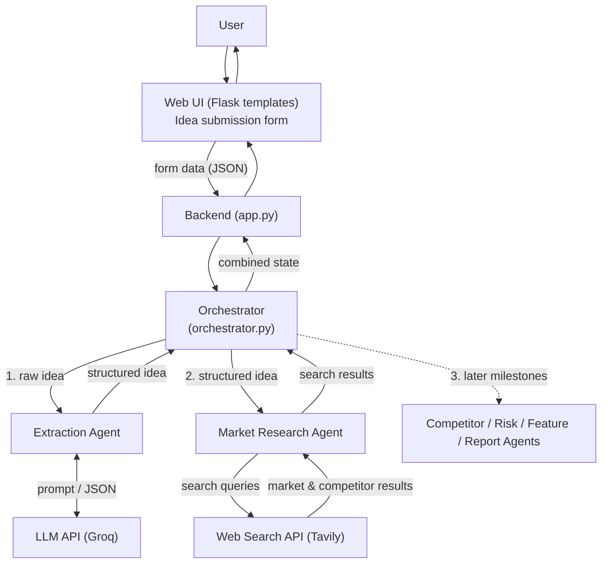

# Multi-Agent Architecture & Orchestration Flow

## 1. Overview
The AI-Based Startup Idea Validator uses several specialised agents coordinated by a
central **Orchestrator**. The user submits an idea, the orchestrator passes it through
each agent in order, and the combined result is returned to the UI.

## 2. Architecture Diagram



## 3. Agent Responsibilities

| Agent | Responsibility | Input | Output |
|---|---|---|---|
| **Orchestrator** | Controls workflow order, passes data between agents, handles errors | Raw idea from UI | Final combined state |
| **Extraction Agent** | Uses LLM to convert the raw idea into structured JSON | Raw idea text, industry, customers | `problem_statement`, `proposed_solution`, `target_customers`, `industry`, `key_features` |
| **Market Research Agent** | Generates search queries and retrieves live market and competitor data | Structured idea | Search results (titles, URLs, summaries) |
| Competitor Agent *(Milestone 2)* | Identifies and compares competitors | Structured idea + search results | Competitor list |
| Risk Agent *(Milestone 2)* | Analyses strengths, weaknesses, risks | Structured idea + research | SWOT / risk summary |
| Feature Agent *(Milestone 2)* | Recommends the first features to build | All previous output | MVP feature list |
| Report Agent *(Milestone 3)* | Generates the final validation report | All previous output | Final report |

## 4. Orchestration Flow (Milestone 1)
1. User fills in the form (idea, industry, target customers, details).
2. Backend validates input and calls `run_workflow()` in `orchestrator.py`.
3. **Extraction Agent** sends the idea to the LLM and returns structured JSON.
4. Orchestrator passes the structured idea to the **Market Research Agent**.
5. Market Research Agent creates search queries, calls Tavily, returns results.
6. Orchestrator returns a single `state` dict to the backend, which displays it in the UI.

### Shared state passed between components
```json
{
  "raw_idea": {},
  "structured_idea": {},
  "market_research": {},
  "errors": [],
  "status": "success | partial | failed"
}
```

## 5. Error Handling
- **Missing input** → validation error, workflow stops.
- **LLM/API failure or invalid JSON** → logged, workflow stops (later steps need the structured idea).
- **Search API failure** → status `partial`; structured idea is still returned.

## 6. Run
```bash
python orchestrator.py
```
